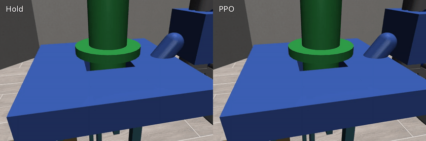

# Contact-Guided Correction Selection After Partner Motion in Simulated Bimanual Insertion

When two robot arms hold parts in contact, one arm can undo the alignment the other just achieved. Can the receiving arm feel that change and choose its next move in time? In this MuJoCo experiment, one Panda moves a pin while the other holds a socket. The socket arm makes a first correction, observes the contact response, then chooses **left, hold, or right**. Its residual PPO policy observes both hands’ pressure maps and the socket arm’s joints. The pin command is hidden.

[Paper (PDF)](paper/bimanual_contact_feedback.pdf) · [Matched replays](#matched-replays) · [Results](#results) · [Run an experiment](#run-an-experiment)

[](paper/media/follow-up-comparison.mp4)

**One grasp, two outcomes.** Both panels start with the same 2.31 mm rightward socket correction and 4.80 mm leftward pin motion. At 0.54 s the panels diverge. Holding leaves the pin outside the clearance threshold. The learned leftward correction restores 1.77 mm of clearance at the settled check. [Full-resolution replay (13 s)](paper/media/follow-up-comparison.mp4) · [Branch measurements](paper/media/follow-up-comparison.json)

## Results

How much does it help to choose the follow-up *after* the partner moves? Every initial condition was replayed under five pin motions and all nine pairs of socket actions. This lets us score even the best pair one could have chosen in advance with hindsight.

| Choice of socket corrections | Held-out materials · 960 paths | New grasps · 360 paths |
| --- | ---: | ---: |
| Learned first correction, then hold | 474 (49.4%) | 188 (52.2%) |
| Best pair fixed before the pin moves | 544 (56.7%) | 205 (56.9%) |
| First correction, then PPO with the observed motion’s feedback | **709 (73.9%)** | **289 (80.3%)** |
| Paired gain over the best fixed pair, percentage points [95% interval] | **+17.19 [14.79, 19.48]** | **+23.33 [20.83, 26.11]** |

The fixed pair can vary with initial condition and material but must cover all five motions at that condition. The material test uses 64 initial draws from two held-out grasps crossed with three material settings. The new-grasp test uses 12 newly acquired grasps with six variants apiece at nominal material. Intervals resample whole initial draws within each material-test grasp or whole new grasps. [Timing analysis and data](analysis/README.md)

**Does the socket arm receive a directional cue through the parts?** In a separate experiment, a policy observing only socket pressure and joints chose different follow-ups for opposite pin motions in **85/96** comparisons with contact intact and **0/96** when pin–socket contact was disabled. Both hands kept their grasps. These trials end at the second decision and measure the *choice of action*. [Contact experiment and recorded force traces](mechanism/README.md)

**What do the pressure maps add?** At fixed total load, a prespecified shuffle of the socket’s 64 pressure cells reduced material-test successes from 709 to 609. Substituting the load-matched spatial pattern from the same grasp with the pin stationary gave 699. The policy is sensitive to pressure location. A separately trained socket-wrench policy reached 722/960, so the added benefit of spatial sensing over aggregate force remains open. [Sensor comparisons in the paper](paper/bimanual_contact_feedback.pdf)

## Matched replays

The three examples below use the **same grasp, material and first socket correction**. Each is the first path in the released material-test order with its outcome. Before the follow-up, only the pin command varies across rows. Within a row, holding and PPO start from exactly the same post-motion state. The last column counts all material-test paths with that outcome.

| Replay | Pin motion | Hold follow-up | PPO follow-up | Paths / 960 |
| --- | --- | --- | --- | ---: |
| [Recovery](paper/media/follow-up-comparison.mp4) | Large left | Hold · fails | Left · succeeds | 235 |
| [Success preserved](paper/media/preserved-success.mp4) | Stationary | Hold · succeeds | Hold · succeeds | 474 |
| [Missed recovery](paper/media/shared-failure.mp4) | Small left | Hold · fails | Hold · fails | 251 |

No hold success became a failure under the learned follow-up on this cohort. On the 360 new-grasp paths there were 101 recoveries, 188 preserved successes, 71 shared failures and zero lost successes. Every success requires engagement, depth, clearance, angle and grip to pass at both 0.88 s and 1.00 s.

**Success preserved · stationary pin.** After its first correction the socket arm holds. The two panels coincide because the policy chooses the same action as the reference. [MP4](paper/media/preserved-success.mp4) · [Measurements](paper/media/preserved-success.json)

[](paper/media/preserved-success.mp4)

**Missed recovery · small leftward pin motion.** Here the policy also holds. Both panels end with 0.063 mm clearance, below the 0.10 mm threshold. In a separate replay from that same state, the leftward correction that PPO passed up reaches 1.196 mm and passes both checks. [MP4](paper/media/shared-failure.mp4) · [Measurements for the chosen and alternative actions](paper/media/shared-failure.json)

[](paper/media/shared-failure.mp4)

[Verify the example selection, archived outcomes and video files](scripts/verify_gallery.py) with `python scripts/verify_gallery.py`.

## Experimental setup


The socket policy adjusts a servo reference twice within a one-second maintenance trial. Its second decision uses three sensor samples from the first correction and three from the partner’s motion. Simulation branches share the same physical state up to the decision under comparison.

<details>
<summary>Watch the arms acquire a fresh grasp (8 s)</summary>

[](paper/media/grasp-acquisition.mp4)

This separate recording shows the scripted setup of a new grasp before the learned corrections begin. [Full-resolution MP4](paper/media/grasp-acquisition.mp4)

</details>

## Run an experiment

On GitHub, open [Run paper experiment](https://github.com/BitAdventurer/bimanual-contact-feedback/actions/workflows/experiments.yml), select **Run workflow** on `main`, and choose a run.

| Workflow option | What it runs |
| --- | --- |
| `results` | Recompute the timing comparison, contact intervention and scores for the paper’s 18 locked actor checkpoints. A hosted CPU run took about 40 seconds. |
| `native-smoke` | Replay 45 physical branches in MuJoCo. |
| `end-to-end` | Regenerate the held-out material trajectories and contact intervention, retrain six three-seed ensembles on archived training transitions, and score the selected models on the regenerated test trajectories. Allow roughly half an hour with two hosted CPU workers. |

Results appear in the job log and downloadable workflow artifact. To reproduce the paper’s numbers locally from the repository root, run the following with Python and NumPy.

```bash
python3 -m venv .venv
source .venv/bin/activate
python -m pip install -r analysis/requirements.txt
python analysis/reproduce.py
python mechanism/verify.py
python training/run.py evaluate --run training/reference --json runs/paper-checkpoints.json
python scripts/verify_gallery.py
```

<details>
<summary>Run the physics simulator and retrain locally</summary>

The reference environment is Linux x86-64 with CPython 3.8.20. Use a virtual environment created with that interpreter. These headless experiments run on CPU.

```bash
python -m pip install -r simulation/requirements.txt
python -m pip install --no-deps robosuite==1.4.1
python -m pip install --only-binary=:all: --no-deps 'torch==2.4.1+cpu' --index-url https://download.pytorch.org/whl/cpu
python -m pip install -r training/requirements.txt
bash scripts/reproduce.sh runs/full 2
```

The last argument sets the CPU worker count. Choose a new output directory for each full run. See `runs/full/native-test.json` for the trained policy scores and `runs/full/native-contact-cut.json` for the contact comparison. The individual steps can also be run separately.

```bash
python simulation/replay.py smoke
mkdir -p runs
python simulation/replay.py test-grid --workers 2 --output runs/native-grid.npz
python -m mechanism.replay --workers 2
python training/run.py smoke
python training/run.py fit --out runs/contact --workers 2 --controls
python training/run.py evaluate --run runs/contact --json runs/contact/test.json
python training/run.py evaluate --run runs/contact --native-test runs/native-grid.npz --json runs/contact/native-test.json
```

</details>

### Data, code and replication

| Directory | Contents |
| --- | --- |
| [analysis](analysis/README.md) | Frozen choices, physical outcomes, matched and reassigned motion histories, paired intervals. |
| [mechanism](mechanism/README.md) | Contact-intact and contact-cut force traces, socket-local policy and native replay. |
| [simulation](simulation/README.md) | MuJoCo scene, archived grasp states, branches and insertion checks. Panda meshes come from robosuite. |
| [training](training/README.md) | Training transitions, controls, frozen checkpoints and validation-based selection. |
| [paper](paper/) | Five-page manuscript, simulation footage and replay measurements. |

Assigning an independent motion history to the same first action gave expected scores of 418/960 and 161.8/360. These average all five possible histories, including a possible match. Material-randomized PPO scored 709/960 against 462/960 for nominal-only training at equal training size, with 335 gains and 88 losses on matched paths.

Fresh fits can vary across CPU implementations. A [GitHub CPU training run](https://github.com/BitAdventurer/bimanual-contact-feedback/actions/runs/44360999139) scored 716/960 for randomized training and 462/960 for nominal training. A local Haswell-kernel run scored 703/960 and 462/960 on regenerated paths. A Python 3.11/PyTorch 2.7 fit scored 700/960 and 462/960. These replications share the same test draws.
