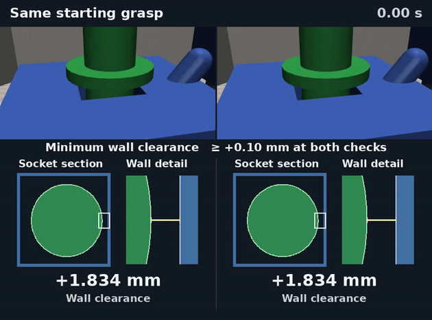
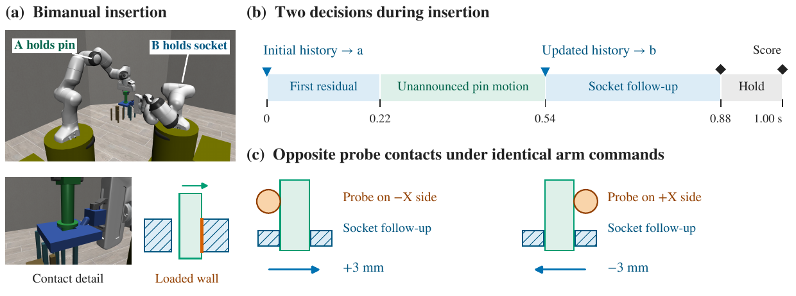
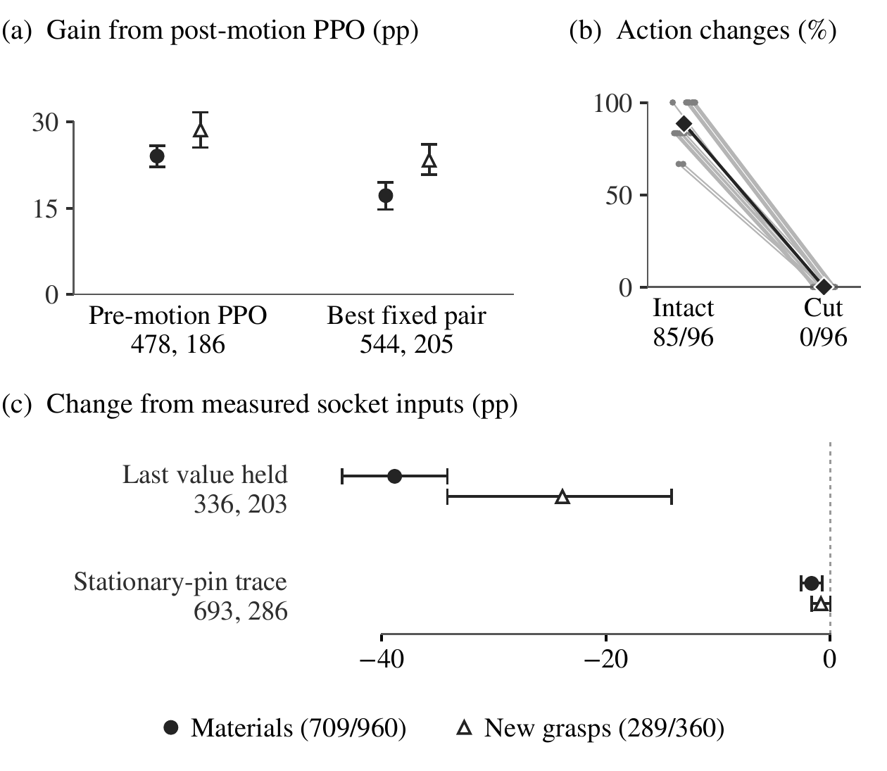
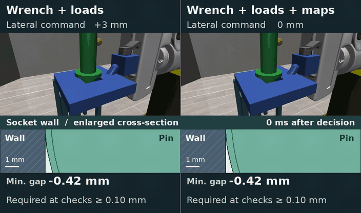
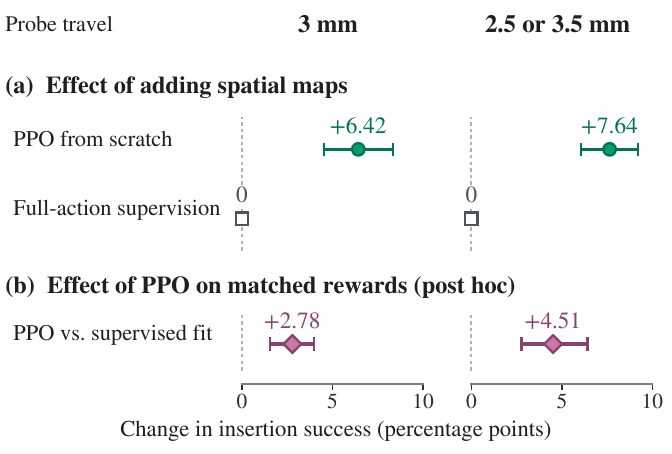
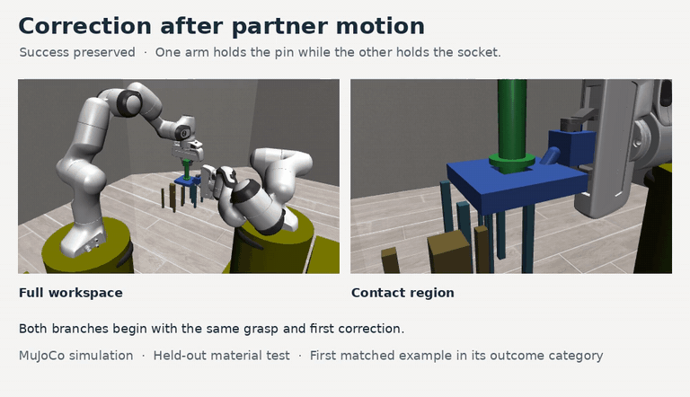
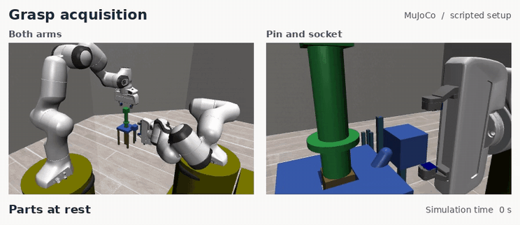
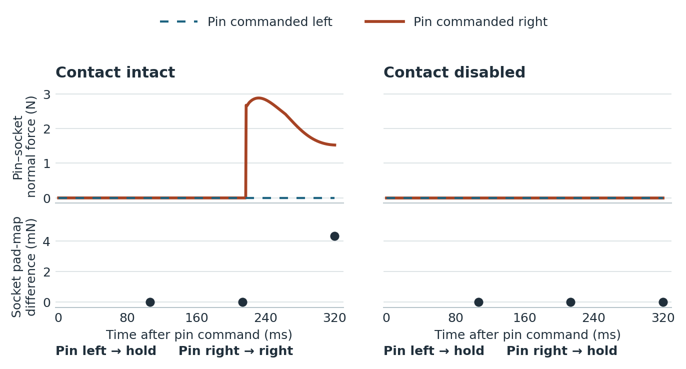
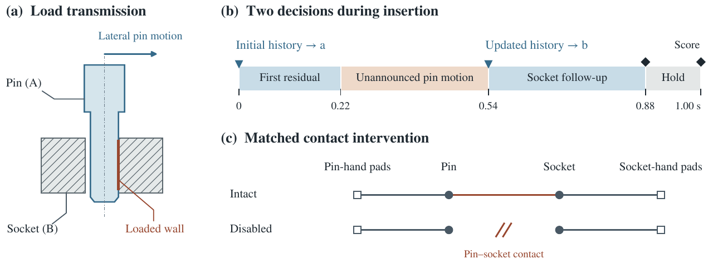

# When Spatial Tactile Feedback Improves Follow-Up Corrections in Bimanual Insertion

Chang-Hoon Ji, Yu-Kyum Kang, Ji-Young Hwang, and Tae-Eui Kam · Department of Artificial Intelligence, Korea University, Seoul, Republic of Korea

[Paper (5-page PDF)](paper/bimanual_contact_feedback.pdf) · [Watch the probe comparison](#what-the-pressure-maps-changed) · [Partner-motion results](#partner-motion-results) · [External-probe results (Table I)](#table-i-external-probe-in-fig-1c) · [Matched replays](#matched-replays)

The pin starts partly inserted. Arm A holds the pin and arm B holds the socket. Can B keep the pin engaged by choosing its next correction after contact changes? In Fig. 1(b), A shifts the pin or holds between B's two decisions. In Fig. 1(c), A is braced and an external probe loads the pin. B always releases along Y and chooses how far to move along X, including zero.

### Watch the socket correction

<p align="center"><a href="paper/media/recovery-wall-detail.mp4"></a></p>

**Partner motion, Fig. 1(b).** The upper views show the same pin motion. At 0.54 s the left branch holds the socket reference and the right branch commands a 4.74 mm leftward correction. Look inside the **white box** in each socket section. The adjacent view enlarges that edge and turns the nearest wall upright. The yellow line marks the gap. At the last check the signed gap is **−0.057 mm** with hold and **+1.769 mm** with correction. Both hands keep their respective grasps in both branches. [Full-size video](paper/media/recovery-wall-detail.mp4) · [Final frame](paper/media/recovery-wall-detail.png) · [Both checks and source replay](#recovery)

## Partner motion

In Fig. 1(b), B makes two decisions while both arms hold the parts. [Simulation setup and command timing](simulation/README.md#experimental-setup) · [Reproduce the partner-motion results](#reproduce-the-results)



- **First correction.** The socket arm shifts its servo reference left or right, or holds. The pin arm then makes one of five unannounced lateral motions, including a stationary command.
- **Follow-up.** After the pin command, a residual policy trained with proximal policy optimization (PPO) chooses left, hold or right. It reads both hands’ 8 × 8 pad-force maps and the socket arm’s joint history.
- **Matched comparison.** Restoring the same simulated grasp lets us try all nine socket-action pairs for each pin motion. We score engagement, depth, clearance, angle and grip at 0.88 s and again at 1.00 s.

### Partner-motion results

The socket policy maintained or recovered insertion on **709 of 960** material-test paths. Even with hindsight, the best pair of actions fixed before the pin moved succeeded on **544**. The fixed pair can vary across initial conditions and materials but must handle all five pin motions at that condition.

| How the socket arm chooses its follow-up | Held-out materials · 960 paths | New grasps · 360 paths |
| --- | ---: | ---: |
| Hold after the learned first action | 474 (49.4%) | 188 (52.2%) |
| Best action pair fixed before pin motion | 544 (56.7%) | 205 (56.9%) |
| **PPO with feedback from the actual motion** | **709 (73.9%)** | **289 (80.3%)** |
| Paired gain over the best fixed pair, percentage points [95% interval] | +17.19 [14.79, 19.48] | +23.33 [20.83, 26.11] |

For opposite large pin motions after the same first correction, no common follow-up could succeed on both sides in 124 of 192 material-test conditions and 66 of 72 new-grasp conditions, even though each side admitted a successful action. The policy succeeded on both sides in 41 and 31 of those conditions, respectively. This descriptive comparison uses the same frozen test paths.

The material test uses 64 initial draws from two held-out grasps, each tested under three material settings and five motions. The second test uses 12 newly acquired grasps, each with six variants and five motions at nominal material. Intervals resample whole initial draws within each material-test grasp or whole new grasps. [Paired analysis and data](analysis/README.md)

<p align="center"></p>

**What passes through contact?** In a separate test, a policy sensing only the socket hand chose different follow-ups for opposite pin motions in **85/96** comparisons with part contact intact and **0/96** after contact was disabled. Both hands kept their grasps. Panel (b) counts action changes. Panels (a) and (c) compare retention rates with contact intact. [Contact experiment](mechanism/README.md)

**Socket-map sensitivity.** On the 960 material-test paths, the frozen policy retained 709 insertions with the measured socket map. With total load held fixed, it retained 699 using the matched stationary-pin distribution and 609 under the prespecified shuffle of all 64 cells. A separately trained wrist-wrench policy reached 722/960. The simulated rigid pads put 99.97% of the training socket load on four corner cells on average. These interventions test sensitivity to rearranging that input.

## When spatial tactile feedback helps

In Fig. 1(c), both arms receive identical commands across probe conditions up to B's decision. A stays braced while the probe presses the pin from either side or remains parked. B then unloads along Y and chooses one of five X offsets. We compare B's six-axis wrist wrench and both hands' total loads with the same inputs plus a fingertip pressure map for each hand.

### What the pressure maps changed

<p align="center"><a href="paper/media/probe-policy-comparison.mp4"></a></p>

**External probe, Fig. 1(c).** Both socket policies execute the planned release along Y. Watch what they add along X. With wrist wrench and total loads, PPO commands **+3 mm** and loses wall clearance. With the spatial pressure maps added, PPO commands **0 mm** and retains insertion at both checks. The final gaps are **−0.122 mm** and **+0.819 mm**, respectively. This is one of 27 such recoveries in the 3 mm probe cohort. [Full-size video](paper/media/probe-policy-comparison.mp4) · [Matched branch measurements](paper/media/probe-policy-comparison.json)

### Table I. External probe in Fig. 1(c)

Each test contains 576 conditions from 32 held-out grasps, including 192 with the probe parked. **Retained conditions** counts each condition where the pin stays engaged at both checks, 340 and 460 ms after B's decision. **Pairs with both sides retained** counts a matched left/right probe pair once if both sides succeed. Only pairs that require opposite lateral corrections qualify, giving 35 pairs at 3 mm and 43 at the new probe travels.

| Controller | Retained conditions<br>3 mm | Retained conditions<br>2.5 or 3.5 mm | Pairs with both sides retained<br>3 mm | Pairs with both sides retained<br>2.5 or 3.5 mm |
| --- | ---: | ---: | ---: | ---: |
| Zero lateral correction | 308/576 | 306/576 | 0/35 | 0/43 |
| Command-only supervised | 361/576 | 355/576 | 0/35 | 0/43 |
| Wrist-force rule | 432/576 | 442/576 | 29/35 | 36/43 |
| PPO from scratch, wrench and total loads | 511/576 | 510/576 | 29/35 | 38/43 |
| PPO from scratch, with spatial maps | 548/576 | 554/576 | 35/35 | 43/43 |
| Full-action supervision, wrench and total loads | 548/576 | 554/576 | 35/35 | 43/43 |
| Full-action supervision, with spatial maps | 548/576 | 554/576 | 35/35 | 43/43 |
| Best available action per state | 548/576 | 554/576 | 35/35 | 43/43 |

Adding maps to PPO changed the chosen command in 123 and 145 of 576 conditions on the two tests. Those changes recovered 37 and 44 insertions, respectively, while preserving every previous success. In 27 and 28 of those recoveries, the map policy omitted an extra +3 mm lateral move that had lost insertion. With all five action outcomes available for supervision, the wrist wrench and total loads already sufficed at every state where one of the five candidates could succeed. [Paired estimates and grasp-level intervals](analysis/probe_results.json)

<p align="center"></p>

## Matched replays

The three partner-motion examples share a grasp, material and first socket correction. Each is the first archived path with its pair of outcomes. Only the recovery example has different follow-up commands in the two branches. [Watch both arms acquire the parts](#grasp-acquisition) for the wider setup.

| Episode | Pin command | Holding the socket reference | Learned follow-up | Material-test paths |
| --- | --- | --- | --- | ---: |
| [Recovery](#recovery) | Large left | Fails | Left · succeeds | 235 |
| [Success preserved](#success-preserved) | Stationary | Succeeds | Hold · succeeds | 474 |
| [Missed recovery](#missed-recovery) | Small left | Fails | Hold · fails | 251 |

The learned follow-up preserved all 474 material-test successes under hold. On the 360 new-grasp paths, it recovered 101 hold failures, preserved 188 successes, and shared 71 failures with hold. [Replay verification](scripts/verify_gallery.py)

### Recovery

The pin arm is commanded 4.80 mm left. After the shared decision state, hold gives **−0.064 / −0.057 mm** of wall clearance at 0.88 / 1.00 s. The learned leftward correction gives **+2.310 / +1.769 mm**. Success requires at least **+0.10 mm** at each check, together with the depth, angle, span and grip criteria. [Watch the wall close-up](#watch-the-socket-correction) · [Original camera footage](paper/media/follow-up-comparison.mp4) · [Endpoint measurements](paper/media/follow-up-comparison.json) · [Frame-by-frame geometry](paper/media/recovery-geometry.json)

### Success preserved

<details>
<summary>Both branches hold and pass · stationary pin command</summary>

<p align="center"><a href="paper/media/preserved-success.mp4"></a></p>

The policy selects the reference action, so the views coincide. [Video](paper/media/preserved-success.mp4) · [Measurements](paper/media/preserved-success.json)

</details>

### Missed recovery

<details>
<summary>Both branches hold and fail · small leftward pin command</summary>

<p align="center"><a href="paper/media/shared-failure.mp4"></a></p>

A receives a 1.97 mm leftward pin command. Both holds end at +0.063 mm of clearance. An additional replay from the same state reaches +1.196 mm with a leftward socket correction and passes both checks. [Video](paper/media/shared-failure.mp4) · [Measurements for all three actions](paper/media/shared-failure.json)

</details>

### Grasp acquisition

<p align="center"><a href="paper/media/grasp-acquisition.mp4"></a></p>

Both arms approach and grasp the parts before bringing them together. This 6.5-second clip shows the scripted setup of a separate new-grasp trial at 4.8× speed. [Play MP4](paper/media/grasp-acquisition.mp4)

### Contact signals

What could the socket hand sense before choosing? The figure follows the first released grasp–material file in the contact-cut experiment, using the socket-local policy’s own first action (hold). The same pin-left and pin-right commands were replayed with contact intact and disabled. This is a separate grasp from the videos above.

<p align="center"></p>

The upper traces show pin–socket normal force over 320 ms. The lower dots show the difference between the left- and right-command socket pressure maps at the three observation times. With contact intact, the rightward command produced a 2.88 N peak and a rightward follow-up. With contact disabled, both commands produced a hold. The socket-local policy also observes joint motion. [Plot from the recorded signals](mechanism/plot_traces.py) · [Experimental protocol](mechanism/README.md)

<details>
<summary>View the experimental timeline</summary>



</details>

## Repository layout

| Directory | Contents |
| --- | --- |
| [analysis](analysis/README.md) | Frozen policy choices, branch outcomes and paired uncertainty estimates. |
| [mechanism](mechanism/README.md) | Contact-intact and contact-cut force traces, socket-local policy and native replay. |
| [simulation](simulation/README.md) | MuJoCo scene, initial grasps, physical branches and insertion criteria. Panda meshes come from robosuite. |
| [training](training/README.md) | Training transitions, policy controls, frozen checkpoints and validation-based model selection. |
| [paper](paper/) | Manuscript, figures, replay videos and measurements. |

## Reproduce the results

The commands below reproduce the partner-motion analyses and evaluate the released checkpoints. For the external probe, the repository provides the aggregate outcomes for Table I and Fig. 3, including the counts and paired intervals. [External-probe data guide](analysis/README.md#external-probe-comparison) · [Recorded results](analysis/probe_results.json)

Run the partner-motion checks from the repository root.

```bash
python3 -m venv .venv
source .venv/bin/activate
python -m pip install -r analysis/requirements.txt
python analysis/reproduce.py
python mechanism/verify.py
python training/run.py evaluate --run training/reference --json runs/paper-checkpoints.json
python scripts/verify_gallery.py
```

To regenerate the contact signal figure, install Matplotlib in the same environment and run `python -m mechanism.plot_traces`. The timing readout also scores reassigned histories. Pairing an independent motion history with the same first action yields 418/960 and 161.8/360 expected successes, averaging all five possible histories including a match. [Timing analysis](analysis/README.md)

## Run an experiment

To run the partner-motion experiment on GitHub, open [Run paper experiment](https://github.com/BitAdventurer/bimanual-contact-feedback/actions/workflows/experiments.yml), select **Run workflow** on `main`, and choose a run.

| Workflow option | What it runs |
| --- | --- |
| `results` | Recompute the timing comparison, contact intervention and scores for the paper’s 18 locked actor checkpoints. A hosted CPU run took about 40 seconds. |
| `native-smoke` | Replay 45 physical branches in MuJoCo. |
| `end-to-end` | Regenerate the held-out material trajectories and contact intervention, retrain six three-seed ensembles on archived training transitions, and score the selected models on the regenerated test trajectories. Allow roughly half an hour with two hosted CPU workers. |

Results appear in the job log and downloadable workflow artifact.

<details>
<summary>Run the physics simulator and retrain locally</summary>

The reference CPU run uses Linux x86-64 and CPython 3.8.20. Install the following packages in a virtual environment created with that interpreter.

```bash
python -m pip install -r simulation/requirements.txt
python -m pip install --no-deps robosuite==1.4.1
python -m pip install --only-binary=:all: --no-deps 'torch==2.4.1+cpu' --index-url https://download.pytorch.org/whl/cpu
python -m pip install -r training/requirements.txt
bash scripts/reproduce.sh runs/full 2
```

On a machine with an NVIDIA GPU, keep the MuJoCo environment active and point `TRAIN_PYTHON` at a CUDA-enabled training environment. The example uses 15 CPU simulation workers and one GPU trainer. [GPU environment setup](training/README.md#cuda-training)

```bash
TRAIN_PYTHON="$PWD/.venv-gpu/bin/python" bash scripts/reproduce.sh runs/full-gpu 15 --device cuda
```

MuJoCo replays held-out states on the CPU while the GPU fits the partner-motion policies on archived training transitions. Validation selects checkpoints. Final scoring starts when both the fit and held-out replay have succeeded. Use a new output directory for each run. Its `native-test.json` contains the trained policy scores and `native-contact-cut.json` contains the contact comparison. The individual steps can also be run separately.

```bash
python simulation/replay.py smoke
mkdir -p runs
python simulation/replay.py test-grid --workers 2 --output runs/native-grid.npz
python -m mechanism.replay --workers 2
python training/run.py smoke
python training/run.py fit --out runs/contact --workers 2 --controls
python training/run.py evaluate --run runs/contact --json runs/contact/test.json
python training/run.py evaluate --run runs/contact --native-test runs/native-grid.npz --json runs/contact/native-test.json
```

</details>

### Training replication

Material-randomized PPO scored 709/960 against 462/960 for nominal-only training at equal training size, with 335 gains and 88 losses on matched paths. Fresh fits can vary across CPU implementations. A [GitHub CPU training run](https://github.com/BitAdventurer/bimanual-contact-feedback/actions/runs/44360999139) scored 716/960 for randomized training and 462/960 for nominal training. A local Haswell-kernel run scored 703/960 and 462/960 on regenerated paths. A Python 3.11/PyTorch 2.7 fit scored 700/960 and 462/960. These replications share the same test draws.

## Citation

Chang-Hoon Ji, Yu-Kyum Kang, Ji-Young Hwang, and Tae-Eui Kam. *When Spatial Tactile Feedback Improves Follow-Up Corrections in Bimanual Insertion*. Korea University. [Manuscript](paper/bimanual_contact_feedback.pdf) · [Citation metadata](CITATION.cff) · [Manuscript references (BibTeX)](paper/references.bib)
